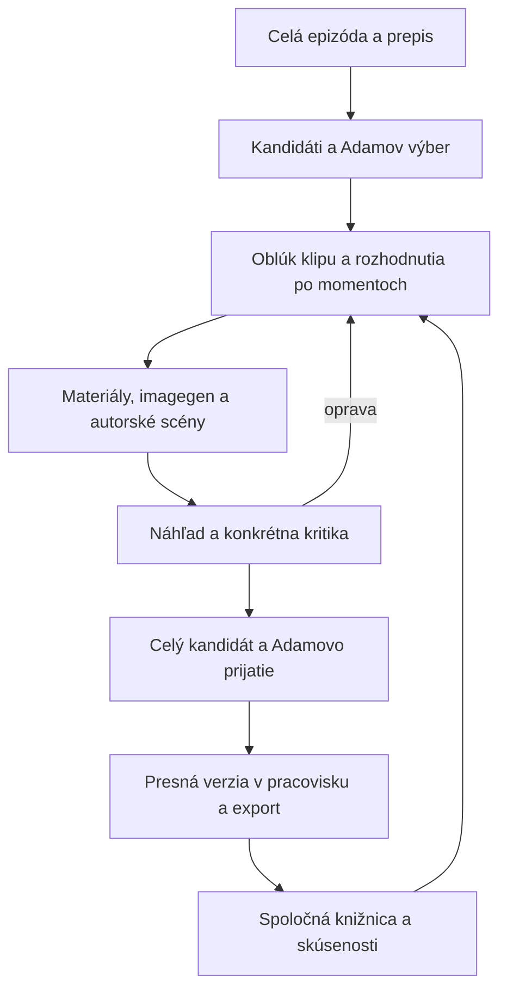

# Plán jednotného systému klipovania Fikiho

Aktuálny implementačný plán od 4. novembra 2026. Záväzný produktový a prevádzkový rozsah určujú [dohody, najmä 10.12–10.15](docs/XVADUR_CLIPPING_SYSTEM_DOHODY.md#1015-aktuálny-prevádzkový-kontrakt-cloudflare-drive-mac-cli--oprava-4-novembra). **Aktívne etapy sú C0–C6 nižšie.** Starý plán P0–P7 je zachovaný v oddelenej historickej prílohe s pôvodnými dôkazmi; nepredstavuje druhé aktuálne zadanie.

## Aktuálny výsledok a pevné rozhodnutia

Jeden integrovaný systém prispôsobí existujúce klipy.xvadur.com: Adam odovzdá ZIP, systém pripraví celú epizódu, AI vyberie obsahovo vhodných kandidátov, navrhne pestré spracovanie, zabezpečí médiá, vyrobí a skontroluje klipy. Adam cez web prehrá presnú verziu, pripomienkuje ju a prijme do publikačného plánu. Príprava materiálov ďalších klipov pokračuje počas renderu a kontroly predchádzajúceho výsledku. Samotný dashboard, prázdna fronta ani syntetický priechod tento výsledok nenahrádzajú.

- Jediný klient je Fiki. AI výber nesie pôvod delegated-ai; neuvádza sa ako Adamov výber. Adam zostáva autoritou tvorivého prijatia výsledku a nového spoločného vizuálneho jazyka.
- Web, static assets, prihlásenie, API a centrálna autorita stavu/fronty budú na Cloudflare Workers + D1. Google Drive uchováva nemenné médiá, Mac ich aktívnu cache. Codex CLI, lokálny prepis, Remotion 4.0.529 a FFmpeg bežia na Macu bez otvoreného desktopového chatu. Linux server sa neobstaráva.
- Štartovací cieľ je 8 unikátnych klipov denne, jeden na každý z 8 účtov, bez repostovania jedného klipu na ostatné. Po prvých 16 videách sa vyhodnotí kvalita, čas, cena a Adamove zásahy; zvýšenie tempa nie je automatické. Prvý väčší míľnik je 200 unikátnych klipov.
- Z novej epizódy sa vyrábajú všetky použiteľné samostatné klipy bez pevného početného stropu. Nové epizódy majú prioritu, staršie overené 4K zdroje dopĺňajú zásobu. Limit aktívnych jobov neobmedzuje počet uložených kandidátov.
- Požadovaný vertikálny master je 2160 × 3840. Proxy a náhľady môžu byť ľahšie; finál používa overený zdroj a platformový export podľa skutočných možností účtu/API. Zvýšené rozlíšenie plátna nepreukazuje detail originálu.
- Astra pripravuje koncept a tvorivé rozhodnutia, 6.1 vykonáva konkrétne zadané úlohy. Profil, skutočne použitý model, nástroje, vstupy a výsledok sa evidujú. Nástroje desktopového chatu sa nepovažujú za automaticky dostupné v CLI.
- Tvorivá latka vychádza z prijatých Vajanského, Električky, Pas r4, Čokolád r5 a doložených opráv. Bohatý edit sa nesmie zredukovať na kalibračný preset ani počítadlo efektov. Knižnica rastie zo skutočnej výroby; nové hľadanie a generovanie sú riadne voľby podľa významu, bez povinnej prvej brány cez knižnicu.
- Zvuky možno bežne získať ako vhodné hotové súbory z knižnice; generovanie nie je povinnosťou pre každý SFX. ElevenLabs sa používa cez API podľa [spresnenia 10.16](docs/XVADUR_CLIPPING_SYSTEM_DOHODY.md#1016-hotové-zvuky-a-elevenlabs-cez-api--spresnenie-počas-implementácie-4-novembra).

## Východisko a pravdivý stav buildu

**Stav 4. novembra: implementácia prebieha.** Rozpracované sú Cloudflare/D1 vrstva v workplace/cloud/, spoločný verejný kontrakt workplace/shared/production.ts, worker API, obnoviteľný prenos a streamovanie Drive médií, migračný export zachovávajúci všetky entity a pôvodné JSON bajty, integrácia tmavého štúdia v existujúcom workplace/src/ a úpravy lokálneho runtime pre cache, streaming hash, modelové roly a 4K master. Existencia súboru alebo nastavenej hodnoty nie je dôkaz integračného úspechu.

**Prevádzkovou autoritou zostáva workplace/data/workplace.sqlite až do overeného odovzdania autority do D1.** Aktuálny build nesmie viesť dvojité zápisy do dvoch nezávislých registrov. Drive autorizácia, živé nasadenie a produkčný cutover zatiaľ neboli vykonané. Tento dokument nevyhlasuje nové testy za úspešné.

Použiteľné kanonické kontrakty Transcript, Selection, EditPlan, Timeline, slovné kotvy, receipts, revízne transakcie a knižnica sa zachovávajú. Historické technické overenia P0–P6 zostávajú platné iba v rozsahu príslušných reportov; P2 tvorivé prijatie a P7 zostali otvorené. [Sociálna integrácia](docs/SOCIAL_API_SETUP.md) dokladá autentifikované API čítanie 8/8 účtov; upload oprávnenia, vykonanie a prevádzka sa overujú samostatne. Hotové účty sa nepripájajú znova bez konkrétneho dôvodu.

## Aktívne implementačné etapy C0–C6

Etapy sú vnútorné časti jedného buildu. Ich rozdelenie nevyžaduje opakovať už prijaté produktové rozhodnutia a neumožňuje odovzdať iba web bez výroby. Stav prebieha znamená rozpracovanie, nie splnené kritériá. Dokončenie sa zapíše až s konkrétnym dôkazom všetkých príslušných brán.

| Etapa | Stav | Implementačný rozsah | Overiteľná brána |
| --- | --- | --- | --- |
| **C0 Kontrakty, inventár a migrácia** | **prebieha** | Zosúladiť jeden aktuálny plán, oddeliť historický rozsah, inventarizovať SQLite a kanonické artefakty, pripraviť opakovateľný export/import všetkých entít a pôvodných JSON bajtov. Uchovať identity, prijatia, pôvody, hashe, väzby a šifrované poverenia. | Na izolovanej kópii porovnať počty, ID, surové JSON telá, referencie, prijaté hashe a metadata podľa klasifikácie. Opakovaný import nesmie pridať entity ani zmeniť prijatie. Existujúca SQLite ostáva prevádzková. |
| **C1 Cloudflare stav, API a fronta** | **prebieha** | Workers + static frontend + D1, prihlásenie používateľa a samostatná autentifikácia Mac workera, atomický claim, lease/fencing, heartbeat, idempotentné operácie a výsledky. D1 po cutover vlastní aj revízne hlavičky a stav závislostí. | Súbežné claimy nepridelia rovnaký pokus dvakrát. Expirovaný worker neprepíše novší pokus/revíziu. Opakovaný rovnaký výsledok vráti ten istý receipt; odlišný obsah pod rovnakým kľúčom je konflikt. Web a uložená fronta zostanú dostupné pri vypnutom Macu. |
| **C2 Drive médiá, ZIP a pracovná cache** | **prebieha** | Obnoviteľný upload, identity epizódy a zdrojov, overené Drive lokácie, súkromné streamovanie/seek, hashovaná cache a príjem média do kanonického ingestu. | Prerušený prenos sa obnoví bez druhej epizódy alebo nového zdroja; nesúhlas hashov sa odmietne. Web prehrá a vyhľadá čas v náhľade bez Macu. Cache možno obnoviť z potvrdených vzdialených súborov. Skutočný zdroj spĺňa 4K podmienku alebo epizóda viditeľne čaká. |
| **C3 Analýza, agenti a pripravené edity** | **prebieha** | Jeden prepis a mapa celku, banka kandidátov, AI Selection, verziované prompty/profily, konkrétne plány, obrázky/SFX/discovery, spoločný Fiki kit a knižnica. Samostatné materiálové úlohy vytvárajú overený balík ready_for_edit. | Kandidáti sa viažu na skutočné slová a kontext celej epizódy. Povinný asset je skutočný overený súbor. Zmena plánu zneplatní dotknuté závislosti. Klip B pokračuje, keď A čaká na médium; hotové generovanie sa po prerušení neduplikuje. |
| **C4 Lokálna výroba, kontrola a prijatie** | **prebieha** | Jeden náročný zostavovací/renderovací job, spoločný rozpočet CPU/RAM/disku, streaming hash/cache, Remotion 4.0.529, 2160 × 3840 master, kritika/opravy, presný preview bundle alebo MP4 fallback a prijatie konkrétnej verzie. | Obnova po renderi pred doručením nevykoná hotový render znova. Oprava nemení uzamknutú reč a výsledok má kontrolu presných nových bajtov. Schválený náhľadový balík a master majú zhodné obsahové vstupy; obsahová zmena znamená novú verziu. Obraz, pohyb, technika a posluch majú pravdivé oddelené dôkazy. |
| **C5 Existujúce pracovisko a analytika** | **prebieha** | Tmavé štúdio v existujúcom workplace: Prehľad, Videá, Na kontrolu a Výroba; upload, skutočné stavy, thumbnaily, tabuľka výkonu, grafy, filtre, verzie, časované pripomienky a nastavenia rozpisu. Samostatná analytics-app/ sa nestáva autoritou. | UI zobrazuje tie isté entity a revízie ako worker. Pripomienka má presný comment/version/bodyHash a vráti dohľadateľnú opravu. Neznáme metriky zostanú nedostupné; publikácie a unikátne klipy sa počítajú oddelene. Vzhľad sa overí na skutočných obrazovkách vrátane mobilu; build nie je vizuálne prijatie. |
| **C6 Aktivácia, publikovanie a spoločný pilot** | **nezahájené** | Po integračných bránach konkrétne autorizácie, kontrolovaný cutover, API publishing nad schváleným balíkom, merania o 07:00 Europe/Bratislava, reálny pilot #105 a následné meranie prvých 16 unikátnych výsledkov. | Živý web/API ostane dostupný bez Macu a po návrate sa práca obnoví. Schválená presná verzia sa publikuje iba na určený účet, má potvrdené ID/URL a bez duplicitného uploadu po neistom výsledku. Pilot a tvorivé prijatie sa zapíšu podľa skutočnosti; denná kapacita sa uzavrie nameranými výsledkami. |

Poradie závislostí: C0 určuje migráciu a invarianty pre C1; C1 a C2 pripravia spoločný základ pre C3–C4. C5 sa vyvíja súbežne nad spoločným kontraktom, ale integruje sa so skutočnou výrobou pred C6. Rovnako možno súbežne pripraviť modelové profily, renderer a cache; taká príprava nepreskočí brány vzdialených médií ani centrálnej fronty.

## Integrovaný tok a hranice dokončenia

~~~text
ZIP cez web → overený zdroj na Drive → jedna epizóda v D1
    → Mac: ingest/prepis → mapa celku → kandidáti → AI Selection/plán
    → samostatné materiálové úlohy → overený balík pripravený na edit
    → Mac: compile/render → kritika/opravy → presná verzia na webe
    → Adam: pripomienka alebo prijatie → technicky overený master
    → publikačný plán → potvrdený platformový post → datované metriky
~~~

Prijatie presného náhľadového balíka pred master renderom je samostatný nový kontrakt. Existujúce prijatia podľa master hash zostávajú platné a nemenia sa. Pri nepodporovanom živom preview sa použije prehrateľný vyrenderovaný náhľad. Zmena kompozície, reči, kitu alebo média po prijatí vyžaduje novú verziu; samotné technické dokončenie rovnakého schváleného balíka nevyvoláva ďalšie tvorivé prijatie bez dôvodu.

Výrobne dokončený klip má aktuálny celý výstup, dohľadateľné vstupy a kontroly bez otvoreného závažného/blokujúceho nálezu. Tvorivé prijatie patrí Adamovi. Publikovaným sa stáva až po potvrdenom výsledku platformy. Snímky, waveform ani úspešný encode nepredstavujú posluch alebo súvislé prehratie. Pri chýbajúcej overenej AV schopnosti ostáva tento rozsah Adamovej kontrole.

## Migrácia a prevádzkové pravidlá

- D1 je cieľová jediná autorita živého stavu; Drive drží nemenné médiá a payloady, nie synchronizovanú databázu. Mac cache a denník neodovzdaných výsledkov smú obnoviť krok, nesmú samostatne prijímať verzie alebo určovať centrálny head/frontu.
- Staré absolute paths a workspace sú súčasťou niektorých pôvodných payloadov a hashov. Migrácia ich zachová; nová lokácia sa pridá cez mapovanie. Pre nové kontrakty sa identita oddelí od lokácie.
- Výsledok sa najprv uloží a overí, potom podmieneným commitom pripojí k aktuálnej úlohe/revízii. Pád medzi uploadom a commitom sa rieši dohľadaním transferu/výstupu, nie slepým opakovaním generovania.
- Metadata SQLite obsahujú aj šifrované socialApi.secret položky. Migračný export je súkromný; frontend dostáva výhradne explicitnú verejnú projekciu. Kľúče, provider sessions a lease tokeny nepatria do modelového kontextu ani UI.
- Pred cutover sa zastavia staré zápisy, vytvorí konzistentný export, overí import a až potom sa zapne nová autorita. Stará SQLite sa zachová ako historický snapshot. Po nových D1 zápisoch návrat vyžaduje rekonciliáciu týchto zápisov; samotné DNS prepnutie neobnoví dáta.
- Vypnutý Mac pozastaví nevykonané výrobné/API úlohy. Web zobrazí nedostupného vykonávateľa. Zmeškané publikácie sa po návrate presunú do voľných slotov podľa politiky, neodošlú sa všetky naraz. Potvrdený platformový schedule ostáva tá istá publikácia; metriky sa datujú skutočným časom merania.
- Pracovná kópia sa uvoľní až po overenom vzdialenom uložení a zániku aktívnych závislostí. Naplánované masters zostávajú pripravené vykonávateľovi. Retencia a rezerva sa určia meraním, nie svojvoľným mazaním podľa veku.

## Overovanie a aktivácia

Každá etapa doplní konkrétny report: čo sa zmenilo, presný testovaný vstup/verzia, vykonané príkazy, skutočný výsledok a zostávajúce hranice. Lokálna SQLite skúška D1 kontraktu nenahrádza nasadený D1 test; HTTP fixture nenahrádza živé API; nastavené 4K rozmery nenahrádzajú render ani kvalitu. Existujúce regresné testy sa spustia podľa dotknutých modulov, renderové kontroly podľa skutočnej zmeny renderovej cesty.

Spoločný pilot Fiki #105 nasleduje po technickej implementácii. Existujúca ochrana rezervovanej epizódy sa nesmie obísť ako vedľajší účinok refaktoru. Po pilote sa merajú prijaté unikátne klipy, čas do prvého návrhu a dokončenia, čakanie, opravy, náklady, RAM/disk a Adamove aktívne zásahy. Prvých 16 výsledkov je rozhodovací bod; 200 je míľnik výsledkov, nie počet render pokusov. Starý päťklipový pilot a jeho 50-minútový návrh nie sú aktuálne kapacitné zadanie.

Drive prístup je od 4. novembra pripojený a overený vrátane obnoveného prenosu, SHA-256, pripnutej revízie a súkromného prehrávania/seek cez nasadený Worker. Pred aktiváciou zostávajú konkrétne prístupy k ďalším mediálnym nástrojom, potrebné upload oprávnenia a vykonávače, prípadné limity novej platenej spotreby a predvolený publikačný rozpis. Návrh ôsmich slotov v okne 12:00–20:00 a rezervy 24 prijatých klipov nie je aktivovaný ani potvrdený rozpis. Presné minúty neblokujú vývoj. Historické publikácie, účty a automatizácie sa automaticky nemenia.

### Technický checkpoint 4. novembra — priebežný, bez cutover

- Súkromný staging `klipy-staging.xvadur.com` obsluhujú Workers Static Assets + D1. Cloudflare Access povoľuje Adamov existujúci účet. Je v režime `AUTHORITY_MODE=staging`, teda nezapína živé výrobné zápisy. Produkčné `klipy.xvadur.com` a jeho SQLite autorita zatiaľ ostávajú pôvodné.
- Skutočný vzdialený D1 import a spätný export zachovali 23 tabuliek, surové JSON telá, katalóg a identity: 3 klipy/verzie, 312 evidovaných účtov, 2410 publikácií, 3414 meraní a 6 médií. Všetkých 6 médií má overenú súkromnú Drive lokáciu; pôvodné media ID a bajty sa nemenili. Dôkaz je `work/cloud-migration-private/d1-staging-2026-11-04/remote-verification.json`; exporty obsahujú súkromné dáta a nesmú sa publikovať.
- Prihlásený Chrome prehral pôvodný 37.803-sekundový MP4 z Drive cez `/api/media/…`, vyhľadal čas pri konci a dosiahol `readyState=4`. Skutočné Worker požiadavky potvrdili HTTP 206. `cloud-private-playback.png` a `request-proof.json` v tom istom súkromnom adresári zachytávajú výsledok. Fyzické vypnutie Macu nebolo vykonané; nová Worker cesta médiá nečíta cez Mac tunnel.
- Modelové role, lokálna cache, ZIP ochrany, centrálne lease/receipts, nemenné revízie, preview-only audio a nové prijatie náhľadového balíka majú technické testy. Nový Fiki kit zostáva `calibration`; reálne syntetické 1080 aj 2160 rendery prešli. Súborová existencia a tieto testy nepreukazujú nový tvorivo prijatý Fiki klip.
- Zostáva úplné integračné overenie spoločného graphu vrátane komentárovej opravy, nadväzujúceho mastera a centrálneho publishera, strojový prístup cez Access, neaktívne pripravená služba Macu, overený cutover a spoločný pilot #105. Etapy C0–C6 sa týmto checkpointom automaticky neuzatvárajú.

### Autorská cesta — overená ukážka 6. novembra 2026

Príkaz `autor` poskytuje celý pripnutý `remotion-reel` nástrojovému Codex procesu a vykonáva vlastnú kompletnú TSX kompozíciu nad pôvodným hlasovým a slovným časom. Má samostatné manifesty, treatment revízie, obnovu a izolovaný runtime Remotion 4.0.529. Postup a rozsah overenia sú v [AUTORSKE_SCENY.md](docs/AUTORSKE_SCENY.md).

Na #109 Korytnačka vznikol celý 843-snímkový master 2160 × 3840 / 25 fps, SHA-256 `32fbfc47596b03ca79e8ca5921affd139a67f5f19d8ea1ef86c4533c96e1424e`. Je uložený v `fiki/epizody/109/klipy/korytnacka/praca/authoring-2026-11-06/vystup/`. Skutočný náhľad odhalil chyby spojov a AAC primingu; opravený celý master prešiel dekódovaním a technickou kontrolou bez nálezu. Obraz bol skontrolovaný na vzorkovaných snímkach vrátane spojov; nejde o posluch, súvislé prehratie ani Adamovo tvorivé prijatie. Dokladá autorskú výrobnú cestu, nie kapacitu 1 200 prijatých klipov mesačne, centrálnu integráciu či dokončenie etáp C0–C6.

## Súvisiace autority

- [Aktuálne dohody](docs/XVADUR_CLIPPING_SYSTEM_DOHODY.md) uchovávajú pôvod a poradie Adamových rozhodnutí; 10.15 ruší starší Linux/Mac-off výrobný režim.
- [Architektúra](docs/ARCHITEKTURA.md) určuje hranice D1, Drive a lokálneho vykonávania, verzie a integračné operácie.
- [Sociálne API](docs/SOCIAL_API_SETUP.md) rozlišuje udelené prístupy, overené čítanie, chýbajúce odosielanie a prevádzku.
- [Výrobný postup](docs/CODEX_VYROBNY_POSTUP.md), [rozhodovanie o edite](docs/ROZHODOVANIE_O_EDITE.md) a [používanie](docs/POUZIVANIE.md) opisujú dostupné výrobné operácie; nové príkazy sa dokumentujú až po implementácii a overení.

## Historická príloha: lokálny plán P0–P7

Nasledujúci uzavretý blok zachováva predchádzajúce znenie a dátované dôkazy. Formulácie „aktuálne“, „dnešné“, „zostáva autoritou“ a staré limity sa v ňom vzťahujú na historický kontext. Povinný Adamov predvýber, lokálna SQLite ako konečná autorita, výroba iba v otvorenom chate, päťklipový pilot a vylúčenie redizajnu už neurčujú aktuálny rozsah. Technické invarianty a dôkazy zostávajú použiteľné v doloženom rozsahu; aktívny plán je C0–C6 vyššie.

Historické znenie P0–P7 a priebežné poznámky pred zosúladením

**Najnovší prevádzkový pokyn 4. novembra 2026:** [Cloudflare + Google Drive + Mac CLI, časť 10.15](docs/XVADUR_CLIPPING_SYSTEM_DOHODY.md#1015-aktuálny-prevádzkový-kontrakt-cloudflare-drive-mac-cli--oprava-4-novembra). Web/API a centrálne stavy budú hostované na Cloudflare, médiá na Drive s aktívnou cache na SSD Macu. Codex CLI a mediálna výroba bežia na Macu; vypnutie môže prácu pozastaviť, po spustení sa obnoví. Prenajatý Linux/Hetzner server a jeho rozpočtová otázka sa rušia. Tento novší režim má prednosť pred staršími požiadavkami výroby pri nedostupnom Macu; funkčný rozsah, 8 unikátnych denne, kontrola po 16 a kvalita masterov zostávajú.

**Spoločný build systému a webu — spresnenie 4. novembra 2026:** [časti 10.12–10.14 aktuálnych dohôd](docs/XVADUR_CLIPPING_SYSTEM_DOHODY.md#1012-príprava-dopredu-a-fronta-pripravených-editov--4-november) určujú prípravu materiálov dopredu, frontu pripravených editov, prispôsobenie existujúceho klipy.xvadur a prioritu najvyššej kvality uploadu s 4K masterom. Po uzavretí zostávajúcich prevádzkových volieb má nasledovať jeden integrovaný build. Staršie výhradne lokálne obmedzenie, povinný Adamov predvýber každej pasáže a päťklipový kapacitný pilot nižšie sú historické a nové zadanie neobmedzujú. Kritériá najnovšieho priechodu sú v časti 10.13; implementačný stav P0–P7 sa týmto plánovacím zápisom nemení.

**Samostatná technická integrácia sociálnych účtov, 3. november 2026:** novšie zadanie povoľuje prípravu API pre všetkých osem vlastných/spravovaných účtov aj technickú podporu budúcich účtov. Výsledky, testy a neuzavreté live/serverové kroky sú v [stave API pripojení](docs/SOCIAL_API_SETUP.md). Tento zásah nemení tvorivé prijatia ani dokončenie etáp P0–P7.

**Nadväzujúci návrh od 2. novembra 2026:** Adam teraz definuje ďalšiu iteráciu po jednotlivých častiach v [priebežných dohodách](docs/XVADUR_CLIPPING_SYSTEM_DOHODY.md). Novšie zadanie pri návrhu deleguje výber kandidátov AI a pridáva ZIP vstup cez klipy.xvadur a trvácnu agentovú slučku. Dohodnutý ingest a rozpracovaná analýza sú zapísané tam; nižší stav implementácie a historické rozhodnutia sa tým spätne neoznačujú za zmenené ani overené. Podrobná aktualizácia implementačného plánu bude nasledovať po definovaní správania.

Plán zjednotený 25. októbra 2026; stav aktualizovaný po P0–P2 a následnom pokyne pokračovať. **P0 a P1 sú implementované a technicky overené. P2 je implementovaná a technicky overená v kalibračnom rozsahu; čaká na Adamovo vizuálne prijatie. P3 je implementovaná a technicky overená. P4, P5 a P6 sú implementované a technicky overené; P7 zostáva otvorená. [Dôkazy a hranice P6](docs/OVERENIE_P6_2026-10-26.md), [výrobný postup v Codexe](docs/CODEX_VYROBNY_POSTUP.md). [Dôkazy a hranice P5](docs/OVERENIE_P5_2026-10-26.md). [Dôkazy P4](docs/OVERENIE_P4_2026-10-26.md).** [Dôkazy P0–P2](docs/OVERENIE_P0_P2_2026-10-25.md), [dôkazy a hranice P3](docs/OVERENIE_P3_2026-10-25.md). Technické výsledky starších M0–M8 ostávajú platné iba v rozsahu ich testov; neoznačujú bežnú tvorivú výrobu za dokončenú.

## 1. Výsledok, ktorý staviame

Z celej epizódy pripraviť obsahovo správne kandidáty, po Adamovom výbere systematicky navrhnúť a vyrobiť ich edit, opraviť vlastné chyby a odovzdať prehrateľné návrhy. Každý klip musí zlepšiť spoločnú knižnicu materiálov, postupov a skúseností pre ďalšiu výrobu. Adam má vyberať obsah a tvorivo prijímať výsledok; nemá priebežne vyberať každý obrázok, meme, pohyb a zvuk.

Latkou sú prijaté Vajanského a Električka: konkrétne médiá, významové reakcie, čitateľný vtip, presné načasovanie, živé spracovanie a schopnosť vyhodiť nadbytočnú scénu. Pas r4 je ďalšia prijatá referencia pre súvislý animovaný príbeh a titulky. Neurčuje povinnú podobu každého videa.

**Najnovšia aktualizácia cieľa 4. novembra 2026:** začať s **8 unikátnymi klipmi denne**, po jednom na každý z 8 účtov. **Po prvých 16 videách** posúdiť kvalitu, rýchlosť, náklady a mieru Adamovej asistencie; pri dobrom výsledku možno zvýšiť tempo ešte pred prvým väčším míľnikom **200 unikátnych klipov**. Každý klip ide na jeden účet, bez repostovania na ostatné. Z novej epizódy sa vyrábajú všetky použiteľné klipy bez početného stropu; nové epizódy majú prednosť a staršie 4K originály dopĺňajú zásobu. [Aktuálna dohoda, termínový zámer a zdroje](docs/XVADUR_CLIPPING_SYSTEM_DOHODY.md#109-pravidelnosť-množstvo-a-výrobná-zásoba--4-november). Skoršie ciele 24 denne/672 celkovo a októbrových 5 unikátnych denne už nie sú štartovacím zadaním. Plán kapacitu nesľubuje pred meraním. Samostatná API integrácia a nadväzujúce publikovanie sa riadia novšími dohodami; prijatia, staré publikácie a automatizácie sa touto zmenou cieľa nemenia.

Jediný klient projektu je Fiki.

### Tvorivé spresnenie Adama — 26. október 2026

Pri ukážke reakcie na zimu Adam uviedol, že jeden GIF je málo. Každý klip má mať vlastný výber zvukov, GIFov, B-rollu a obrazového spracovania a využiť všetky vhodné príležitosti; prvý návrh má ísť radšej smerom k väčšiemu obohateniu. Minimálna technická kalibrácia nie je požadovaná tvorivá latka. P2 potrebuje bohatšie prepracovanie. Presné znenie a dátovaný pôvod sú v [tvorivom zadaní r1](fiki/konfiguracia/tvorive-zadanie.r0001.json). Planner dostáva toto zadanie aj plány predchádzajúcich klipov dávky; kritik preveruje nevyužité príležitosti a opakované kombinácie médií. Tvorivá kvalita zostáva predmetom skutočného review, nie počítadla efektov.

Bohatšie prepracovanie zimnej ukážky je vyrobené v r4: dve odlišné reakcie, fotografia a animovaná ilustrácia električky, efekt mrazu, rámovanie a štyri vlastné zvukové akcenty. Pôvodný zdroj, Selection a slová sú zachované. Po obrazovej kontrole je opravené prekrytie úst druhým GIFom. [Výsledok a rozsah overenia](work/implementation-p0-p2/winter-rich-r4/REVIEW.md). Posluch, súvislé tvorivé posúdenie a Adamovo prijatie ostávajú otvorené; P2 nie je prijatá.

## 2. Jeden plán a jeho prílohy

- Tento dokument je autorita rozsahu, poradia, závislostí a kritérií implementácie.
- [Rozhodovanie o edite](docs/ROZHODOVANIE_O_EDITE.md) obsahuje vykonateľný pracovný predpis nad pasážou, vyplnené príklady a kritiku.
- [Architektúra](docs/ARCHITEKTURA.md) oddeľuje dnešnú implementáciu od cieľových rozhraní, nástrojových úloh a autorských scén.
- [Zdrojová a požiadavková matica](docs/PODKLADY_PLANU_2026-10-25.md) vysvetľuje pôvod rozhodnutí, pokrytie dostupných zdrojov a presné medzery.
- [Používanie](docs/POUZIVANIE.md) zostáva návodom k dnešným existujúcim príkazom. Budúce operácie z tohto plánu sa doň zapíšu až po implementácii a overení.

Predchádzajúce znenie plánu, architektúry a vstupných README je v [historickom snapshote](docs/historia/2026-10-25-pred-zjednotenim-planu/manifest.json). Pri čistení rozsahu 28. októbra 2026 boli zo snapshotu odstránené neaktuálne klientské zmienky; manifest rozlišuje pôvodné a aktuálne hashe dotknutých súborov. Staršie návrhy a výskumy sú zdroje, nie ďalšie súbežné zadania.

## 3. Overený východiskový stav

| Oblasť | Čo je použiteľné | Čo tým ešte nie je vyriešené |
| --- | --- | --- |
| Runtime a kontrakty | Samostatný system/, Remotion 4.0.529, vlastné lockfiles, zdroje, slovné kotvy, Selection, EditPlan, Timeline, revízie a export. | Technický úspech syntetického priechodu nie je pravidelná výroba prijatých Fiki klipov. |
| Kanonická pipeline | Existujú import, ASR, index, analýza, modelový plán, resolver, compiler, render, kontrola a runner. | Reálne bohaté klipy vznikali prevažne cez praca/ a autorské workshop kompozície popri tejto ceste. |
| Knižnica | V centrálnom indexe je 10 vizuálov: 7 reakcií, 2 výrezy jedného B-roll zdroja a 1 foto. Ďalších 8 WAV čaká na posluch. Per-klip médií existuje viac. | Spoločné produkčné recepty a centrálna história použitia sú prázdne. Výskumných 115 použití nie je 115 čistých assetov. |
| Vyhľadávanie | library.ts vyhľadáva text/tagy a kontroluje súbory. | resolver.ts z lokálnych zhôd využíva iba presný request fingerprint. Relevantné alternatívy sa nedostávajú do obsahového výberu; planner nevidí hotovú výbavu. |
| Tvorivé plánovanie | SemanticMoment a momentDecisions, jedenásť študijných receptov. | Chýba povinný rozhodovací priechod všetkými editačnými možnosťami a skutočná knižničná opora. Jednoduché SceneSpec vzory nepredstavujú bohaté prijaté scény. |
| Autorský obraz | Prijaté React/SVG scény existujú; worker vie niektoré z nich opravovať v izolovanom snapshote. | Všeobecný renderer dnes nevykonáva ľubovoľný params.renderer z workshopu. Nová autorská scéna nemá dokončené spoločné výrobné rozhranie. |
| Nástroje | Tento chat má imagegen a ďalšie dostupné nástroje; CLI má vlastné explicitné schopnosti. | Headless model.ts a webový worker nezdedia nástroje chatu, imagegen, browser ani jeho session. |
| Kontrola | Decode, rozmery, AV timing, hashe a skutočné vzorkované snímky. | Celkové tempo, pohyb, vtip a mix nie sú preukázané úspešným encódom ani jedným frame. Viaceré finálne reporty majú not_listened. |
| Pracovisko | workplace/ eviduje klipy, presné verzie, pripomienky, joby a výsledky. | Všeobecná Selection/resolver cesta a nové výrobné balíky nie sú kompletne pripojené. Nenahrádza sa novou aplikáciou. |

Tento stav je základ pre rozšírenie existujúceho systému. Neplánuje sa zahodenie dát, nové univerzálne video SaaS ani druhá nezávislá časová os.

## 4. Rozhodnutia o režime a oprávneniach

**D1 — potvrdené Adamom 25. októbra: „ono to cele bude fungovat vramci codexu“.** Výrobu riadi Codex s dostupnými nástrojmi; existujúce lokálne moduly vykonávajú opakovateľné IO, validáciu, náhľady a render. Nástrojová práca sa zaznamenáva do rovnakých artefaktov ako CLI. Chat nie je dátové úložisko a pokračovanie nesmie závisieť iba od jeho histórie.

Pracovný návod a nástroje budú vykonateľné priamo v Codexe. Samostatný externý agent/API orchestrátor nie je cieľom tohto plánu. Existujúci headless planner alebo webový worker môže vykonať iba svoju overenú úlohu; dostupnosť vstavaného imagegenu sa nesmie vydávať za existenciu jeho API adaptéru v takomto procese.

**Platné rozhodnutia bez ďalšej otázky:**

- Výber zdrojových pasáží a tvorivé prijatie sú Adamove rozhodnutia. AI pripravuje alternatívy a vykonáva výrobu medzi týmito bodmi.
- Po výbere dávky sa bežné hľadanie médií, voľby variantov, autorské scény a prvé opravy riešia samostatne. Otázka sa vracia iba pri nejasnom význame, konflikte s uzamknutým rozhodnutím alebo skutočne nevyriešiteľnej potrebe.
- Reč, jej poradie a hranice určuje jedna Selection. Zmena vytvára novú revíziu; obrazový zásah potichu nemení reč.
- Remotion ostáva 4.0.529. Existujúce originály, prijaté revízie a publikované bajty sú nemenné.
- Generovanie obrázkov je riadna výrobná schopnosť. TTS, nahradenie Fikiho hlasu a platené video generovanie nie sú automatickou súčasťou tejto schopnosti.
- Historické automatizácie, rozpis deviatich klipov o 6:00, staré hashtagy a staré počty účtov sa týmto plánom znovu neaktivujú.
- Klientské pravidlá z fiki/konfiguracia/klient.json, doloženej migrácie klient.runtime.json a ich revízií sú vstupným guardom. Zákazy zdrojov/video ID/tém, aliasy a výnimky, limity platených zdrojov a kontext sa kontrolujú pri kandidátovi, Selection aj pred exportom; nové priame rozhodnutie sa zapíše s pôvodom. Nejasný rozsah pravidla sa neodhaduje potichu.

## 5. Výrobný postup jednej epizódy

**Používateľský vstup:** Adam zadá prácu v Codexe. Codex vykonáva uložený postup cez lokálne nástroje a vracia čitateľný prehľad kandidátov, otvorených rozhodnutí a videí. Presné verzie a pripomienky sa sprístupňujú v existujúcom workplace. Adam ručne neprepája JSON ani nespúšťa porty medzi výrobnými krokmi.

**Vlastník práce:** Codex zodpovedá za všetky prípravné, tvorivé, realizačné a kontrolné kroky P0–P7. Adam rozhoduje o Selection, prijatí nového spoločného jazyka a prijatí konkrétnych klipov. Kritická rola má samostatný priechod so skutočnými podkladmi a môže bežať ako read-only subagent; nie je to požiadavka na stálu flotilu služieb.

### A. Obsah a výber

Získať alebo importovať celý zdroj; zdieľať jeden kanonický prepis a obrazový index. Analýza pokryje celú epizódu, osoby, témy, tvrdenia, kontext a tvorivé príležitosti. Kandidát obsahuje presné hranice, hraničné slová, dôvod, možný hook, pointu, kontextové riziká, výsledok klientských kontrol a návrh obrazového potenciálu. Podobné a už publikované pasáže sa označia.

Adam vyberá dávku z čitateľného prehľadu. Výber zostane oddelený od interného návrhu obrazu. Počet výstupov sa nesplní rozsekaním jednej myšlienky alebo vynechaním podmienok výroku.

### B. Rozhodovací priechod nad pasážou

Najprv určiť oblúk celého klipu: prísľub, príprava, vývoj, pointa a záver. Potom rozdeliť reč na významové momenty. Pri každom posúdiť: obraz, meme/humor, B-roll/archív, vlastnú grafiku, imagegen, zoom a rámovanie, titulkový alebo dramatický dôraz, zvuk, prechod, dĺžku a čistý A-roll.

Každá os má výsledok použiť / nepoužiť / odložené a konkrétny dôvod. Povinné posúdenie neznamená povinné vloženie efektu. Výstupom je realizovateľná situácia s kotvami a očakávaným účinkom, nie označenie typu „pridaj pekný B-roll“. [Úplná formula a príklady](docs/ROZHODOVANIE_O_EDITE.md).

### C. Príprava dávky a materiálov

Pred výrobou agent dostane relevantný LibraryContext: použiteľné médiá s náhľadmi, prijaté postupy, obmedzenia a predchádzajúce opravy. Zdieľané osoby, miesta, zvuky a médiá sa hľadajú spoločne pre dávku. Súčasne zostáva možné pripraviť novú autorskú scénu podľa obsahu.

Voľba pre každý potrebný materiál je: existujúci lokálny materiál; dohľadaný presný alebo ilustračný materiál; nová bitmapa cez imagegen; autorská kódovaná scéna. Možnosti sa vyberajú podľa účelu a dostupnosti. Chýbajúce povinné médium vedie k získaniu, odôvodnenej rovnocennej zmene návrhu alebo viditeľnému otvorenému problému.

### D. Výroba a lacná skúška

Kanonický EditPlan odkazuje na vyriešené lokálne materiály a verzie scén. Agent vykoná konkrétny plán vrátane titulkov, rámovania, prechodov a zvuku. Najprv kontroluje kľúčové snímky, nábeh, premenu a návrat; potom prehrateľný draft či krátky úsek s okolím. Až ustálený návrh ide do celého mastera.

Autorský kód môže vytvoriť nový obrazový dej. Musí prejsť izolovanou výrobou a validáciou balíka, potom tým istým compilerom/rendererom a evidenciou ako hotový recept. Pridanie ďalšej priamej položky do Root.tsx mimo tejto cesty nie je dokončením integrácie.

### E. Kritika, oprava a Adamovo prijatie

Samostatný kritický priechod posúdi reálny obraz oproti zámeru a reči. Nález identifikuje revíziu, moment, čas/slovo/prvok, chybu, požadovanú zmenu a spôsob overenia. Autor opraví príslušné miesto, zachová uzamknuté rozhodnutia a znovu overí opravu aj celý klip.

Technická, obrazová, pohybová, posluchová a tvorivá kontrola majú oddelené dôkazy. Časovaná séria snímok a výpočty môžu overiť konkrétny nábeh, polohu a stav, ale nepredstavujú celé prehratie. Bez overenej video schopnosti Codexu sa celkový pohyb a rytmus uzavrú až Adamovým prehratím výsledku; P5 musí túto hranicu priznať, nie ju zakryť existenciou MP4. Bez reálnej posluchovej schopnosti ostáva automatická kontrola zvuku technická; celý master musí vypočuť Adam pri prijatí. Nie je dovolené označiť waveform, ASR alebo screenshot za posluch.

Po maximálne dvoch interných tvorivých kolách sa pri nevyriešenej zásadnej chybe otvorí konkrétny problém; tento navrhovaný limit sa po pilote upraví podľa merania. Neobnovuje sa neobmedzená slučka plných renderov. Ostatné nezávislé klipy môžu pokračovať.

### F. Výstup, knižnica a výsledky

Prijatý export obsahuje presné bajty, pôvod, titulok/popisy a odkazy na výrobné artefakty. Import do workplace zachová clipId, versionId a hash. Príprava distribučného balíka je oddelená od oprávnenia publikovať.

Každý výrobný pokus uloží skutočné použitie a dôvody zamietnutia. Adamovo prijatie povýši iba príslušnú konkrétnu revíziu; vytvorenie všeobecného štýlového pravidla potrebuje jeho osobitný súhlas. Dátované výsledky postov sa priraďujú ku konkrétnym verziám a účtom. Chýbajúca hodnota je neznáma; samotné views neurčujú príčinu úspechu jednotlivého efektu.

## 6. Spoločná výbava

| Kolekcia | Obsah a hlavné väzby |
| --- | --- |
| Obsah epizód | Zdroj, prepis, významové momenty, kandidáti, Selection, už použité/publikované intervaly. |
| Materiály | Súbor, hash, náhľad, skutočná akcia/obsah, osoby/miesta, funkcia, tón, použiteľný trim, reakčný nábeh, crop, zvuk, pôvod a výsledok kontroly. |
| Hooky a dramaturgia | Prehrateľný úvod, pôvodná reč, prísľub, príprava/pointa, vhodný typ pasáže, návrat motívu a obmedzenia. Žiadne vymyslené citáty Fikiho. |
| Produkčný jazyk a recepty | Typografické úlohy, zóny, vrstvy, titulky, kamera, pohyb, zvuková paleta, prechody, spracovanie médií; parametrické scény a príklady. |
| Použitia a skúsenosti | Moment, asset/recept/verzia, účel, parametre, dôvod voľby/zamietnutia, oprava a presné prijatie. |
| Výsledky publikácií | Clip/version hash, účet, verejný post, dátum merania, vek postu a dostupné metriky. Oddelene od výrobnej kvality. |

Kanonické súbory a register zostanú v existujúcej fiki/kniznica. Vyhľadávací index je obnoviteľný odvodený údaj; nezakladá sa druhá pravda v novej databáze. Workplace SQLite ostáva autoritou svojich klipových verzií, pôvodných používateľských komentárov a publikácií, previazanou cez stabilné ID a hashe. Stav výrobnej opravy open/applied/verified/rejected riadi kanonický FeedbackRecord; UI ho iba zobrazuje podľa potvrdeného receipt. Presné pravidlá synchronizácie sú v architektúre.

ProductionPack spája pravidlá a konkrétne implementácie do jedného uceleného balíka: zóny a typografické úlohy, titulky, kameru, foto/GIF/B-roll úpravu, pohyb, prechody, zvukovú paletu, CTA, povolené varianty a prehrateľné referencie. Konkrétny klip odkazuje na presnú verziu balíka; nový import média nevytvára odlišný štýl.

Základný štýl sa odvodí z prijatých referencií. Predpis musí riešiť celú skladbu vrátane zmien full-frame/split, práce s fotkami, GIFmi a zvukom. Vlastný nový obsah môže dostať nový nápad a scénu, pričom zachová spoločný vizuálny jazyk. Rozšírenie jazyka je verzovaná zmena; nemusí vzniknúť nový theme pri každom importe.

## 7. Implementačné etapy

Aktuálny stav: **P0 overená; P1 overená; P2 technicky overená, tvorivé prijatie čaká; P3–P6 technicky overené; P7 otvorená.** Prvý import obsahuje 7 konkrétnych médií a 2 recepty; P2 má jednu parametrickú scénu preverenú na dvoch obsahoch. P3 dopĺňa rozhodovací záznam, knižničný kontext, klientské kontroly a prípravu dávky oddelenú od výroby. Rozsah a testy sú v [reporte P0–P2](docs/OVERENIE_P0_P2_2026-10-25.md) a [reporte P3](docs/OVERENIE_P3_2026-10-25.md). Nasledujúca tabuľka zachováva požiadavky etáp; technické overenie nenahrádza Adamovo prijatie. Historické M0–M8 sa neprečíslujú na hotové P etapy.

| Etapa | Konkrétna práca a výstup | Závislosti | Dôkaz dokončenia |
| --- | --- | --- | --- |
| **P0 Zjednotenie stavu** | Inventár presných reálnych zdrojov, pracovných scén, knižnice, konfigurácie a schopností; migrácie a väzby na historické revízie. | Potvrdený režim D1. | Audit rozlišuje implementáciu, fixture a produkciu; nový root je samostatný; originály a prijaté hashe zostali rovnaké. |
| **P1 Pamäť a materiály** | Import reálnych per-klip médií, anotácií, prijatých/zamietnutých použití; náhľady, trimy, aliasy, zdrojový dedup; funkčný LibraryContext. | P0. | Dotazy na zimu, prisvojenie zásluh, čakanie a konkrétnu Bratislavu vrátia prezreté použiteľné kandidáty; iná formulácia dotazu vie použiť existujúce médium. Duplicita kópie nevytvorí druhý originál. |
| **P2 Produkčný jazyk a autorské scény** | Verzovaný ProductionPack pre celý klip: typografia, kompozícia, médiá, kamera, motion, zvuk a CTA; parametrické postupy a manifest/registry autorskej scény. | P0; P1 dodáva reálne médiá. | Krátka kalibračná ukážka so zdrojovými referenciami preverí skladbu; dva rôzne obsahy použijú rovnaký recept bez prepisu jeho implementácie. Nová scéna ide do spoločnej Timeline, nie mimo nej. Vizuálne prijatie jazyka je Adamovo. |
| **P3 Formula a plán celej dávky** | Rozbor epizódy, kandidáti, rozhodovací záznam všetkých osí, konkrétny plán, lokálne alternatívy, spoločný zoznam potrieb dávky. | P1, návrh rozhraní P2. | Každý významový moment má realizáciu, odôvodnený A-roll alebo otvorenú potrebu. Úvod a pointa sú zachované; klientské zákazy, výnimky a zdrojové limity sú overené, planner vie, ktoré materiály existujú. Produkcia sa nespustí potichu hneď po propose. |
| **P4 Nástrojové vykonanie** | Trvácne požiadavky a príjem výsledkov pre dohľadanie, imagegen a autorský kód; lokálne overenie a napojenie do plánu. | P1–P3. | Skutočná bitmapa z imagegenu sa skopíruje do projektu a použije; chýbajúci výsledok ostane otvorený. Nová scéna má kód, manifest, kontrolu a zhodný náhľad/export. Obnova neopakuje už dokončené generovanie. |
| **P5 Kontrola a opravy** | Autor/kritik, kontrola nábehov a premien, krátke náhľady, celý draft, uzamknuté rozhodnutia, presné nálezy a overenie. | P2–P4. | Zámerné chyby typu duplicitná fotka, neskorá reakcia, odhalenie pred slovom, kolízia a nečitateľný súčet sa nájdu a opravia. Test rozlišuje snímky/pohyb/posluch a overí capability/fallback režim; samotný prehrateľný súbor neuzavrie pohybové hodnotenie. Neobnoví sa schválenie iných bajtov. |
| **P6 Jeden produkčný cyklus a pracovisko** | Projektový pracovný návod/skill pre Codex a jeden riadený vstup od vybratej dávky po návrhy, otázky a výsledky; spoločné joby, resume, import verzií a feedbacku do existujúceho workplace. | P3–P5. | Reštart počas materiálov aj po renderi pokračuje bez opakovania hotových úloh. Nový klip a jeho oprava sú v jednom zázname; live preview je iba pre presne podporovaný bundle, inak MP4. |
| **P7 Reálna prenosnosť a kapacita** | Tri nové Adamom vybraté klipy rôzneho typu najmenej z dvoch zdrojových kontextov; aspoň jeden s novou imagegen scénou a jeden s reuse. Následne samostatný kapacitný pilot piatich denne počas dvoch pracovných dní. | P1–P6. | Kompletná evidencia od zdroja po review a knižnicu, Adamovo prijatie kvality, zmerané zásahy/čas/náklady. Druhý nový klip sám nájde výbavu z prvého. Kvalitatívny prenos a denná kapacita majú oddelený verdikt. Denná kapacita sa uzavrie iba proti časovému a pracovnému rozpočtu nižšie, nie samotným počtom exportov. |

P1 a návrh P2 možno vykonávať súbežne. Analýzu celej epizódy a prípravu potrieb dávky netreba odkladať do prijatia jedného pilotu. Plné rendery ďalšej dávky však nezačnú bez vyriešených povinných vstupov a funkčného spoločného renderového napojenia. Kalibrácia štýlu sa môže opierať o existujúce prijaté edity a krátku ukážku chýbajúcich situácií; jej účelom je uzavrieť opakované rozhodnutia, nie vyrobiť ďalší samostatný showreel bez integrácie.

### Hranice jednotlivých implementačných zásahov

- P1: system/providers/library.ts, resolver.ts, schemas/index.ts; importéry a kanonický index. Neprepisovať pôvodné AssetRecord ani historické prijatia.
- P2/P4: renderer adapter, scény a verzovaný register balíkov; pracovný autor môže pridať novú schválenú implementáciu v izolovanom snapshote. Compiler je stále jediný výpočet snímkového času.
- P3: pipeline/analysis.ts, planner.ts, runner.ts; rozšíriť súčasné artefakty a referencie, nevytvoriť paralelný zoznam strihov.
- P4/P6: lokálny orchestrátor/CLI, trvácne nástrojové úlohy a presný príjem výsledkov. Žiadne predstieranie priameho imagegen volania z dnešného headless modelu.
- P6: jeden projektový pracovný návod/skill pre Codex s krátkym vstupom, krokmi a podmienkami, nástrojovými operáciami, formulármi, príkladmi a zdrojovou mapou. Do kontextu konkrétneho klipu sa načítajú relevantné karty a stav, nie celý archív výskumu ani iba história chatu. Pri návrate Codex určí ďalší krok z uloženého stavu.
- P5: pipeline/review.ts, náhľady a FeedbackRecord; výsledok viazaný na presný plán/médiá/master a skutočný rozsah schopnosti.
- P6: workplace import/worker/preview rozhrania, identita verzií a round-trip pripomienok. Nové základné stránky ani redizajn nie sú podmienkou výrobného jadra.

## 8. Testovanie a dôkaz hodnoty

### Technická regresia

Pri implementácii spustiť príslušné existujúce testy a typecheck; testy renderera iba pri dotknutej renderovej ceste. Zachovať negatívne kontroly zmeneného zdroja, neplatných kotiev, nevyriešeného assetu, zameneného mastera, neznámeho výsledku a izolácie klienta. Presné príkazy sa preberú z aktuálneho package.json a docs/POUZIVANIE.md; tento plán netvrdí, že boli znova spustené.

Nové testy majú preveriť správanie cez verejné rozhranie: obsahovo relevantný reuse s novým dotazom; vyradenie nevhodného lokálneho kandidáta; skutočný trim; zaregistrovanie autorskej scény do všeobecného renderu; príjem presného výsledku imagegenu; resume; zachovanie uzamknutého prvku; použitie nájdenej skúsenosti v druhom klipe. Samotná validácia JSON alebo test kopírujúci implementáciu nestačí.

### Reálna tvorivá skúška

Pred P7 Adam vyberie nové pasáže; existujúce publikované klipy sa nereplikujú ako nové príspevky. Pre každý klip sa doložia zdroj/Selection, formula, LibraryContext, voľby a zamietnutia, skutočné médiá/scény, náhľady, kritika, opravy, master a Adamov verdikt. Zvlášť sa zaznamená jeho úloha: výber, drobná korekcia alebo zásadné tvorivé presmerovanie.

Prvý prijatý klip je dôkaz možnosti. Dva ďalšie odlišné klipy preveria prenos; päťklipová dávka preverí plánovanú prevádzku. Štýlová ukážka, jedna znovuposkladaná Električka a zelené testy samy nenahradia tento rozsah.

### Meranie

Primárne: Adamove aktívne minúty na prijatý unikátny klip a počet zásadných režijných zásahov. Ďalej: čas do prvého celého návrhu, čas opravy, počet interných/ľudských kôl, náklady, čakanie na render, použitie knižnice, pokrytie epizódy a splnenie dávky. Čas medzi chatovými správami nie je aktívny čas.

Navrhovaná latka na kalibráciu: pri troch nových klipoch najviac jedna spoločná dávka bežných pripomienok, bez potreby, aby Adam nanovo vymyslel hlavnú scénu alebo pointu; nulové nevyriešené závažné skreslenie významu. Číselný cieľ času sa určí po zmeraní referencie, nie odhadom podľa YouTube dema. Ak latka neprejde, opraviť konkrétny nedostatok procesu a zopakovať nový prípad; neznížiť požadovanú kvalitu potichu.

Príprava P7 k 26. októbru: [štyri konkrétne zdrojové ukážky a tvorivé návrhy](fiki/davky/p7-pilot-2026-10-26/README.md) sú pripravené pre Adamov výber troch pasáží. Adamov výber nie je zaznamenaný; kvalitatívny ani kapacitný pilot ešte nezačal; príprava sa nepočíta ako splnenie P7.

### Kapacitný pilot P7

Po kvalitatívnom overení sa pripravia a dokončia dve odlišné päťklipové dávky počas dvoch plánovaných pracovných dní. Pred začatím sa zapíše denný časový a Adamov aktívny rozpočet, dostupnosť finálnej kontroly a kapacita stroja. Pracovný návrh je najviac 24 hodín od vstupu dennej výroby po päť prijatých unikátnych klipov a najviac 50 minút Adamovej aktívnej práce na deň vrátane výberu a kontroly; tento ľudský rozpočet sa potvrdí pred skúškou, nie spätne podľa výsledku.

Meranie zahŕňa prípravu novej epizódy v deň jej príchodu, hľadanie/generovanie, plánovanie, čakanie na stroj a review, opravy aj export. Jednorazová stavba systému sa vykáže samostatne. Ak čas alebo kvalita neprejde, výsledok je napríklad „prenos kvality overený, päť denne zatiaľ neoverené“. Päť videí vyrobených za týždeň dennú kapacitu nesplní. Úspech dvoch dní je pilotný nameraný výsledok s uvedenými podmienkami, nie záruka každej budúcej témy.

## 9. Kontrola úplnosti zadania

| Požiadavka | Výstup plánu / implementácie | Kde sa preukáže |
| --- | --- | --- |
| Klientské pravidlá a výnimky | Verzovaný vstup pravidiel; kontrola zdroja, tém, aliasov a plateného rozsahu. | P0/P3/P5, negatívne prípady a exportový guard. |
| Celá epizóda a obsahový kontext | Spoločná analýza, kandidáti a prijatá Selection. | P3, reálne P7. |
| Formula nad každou pasážou | Záznam účelu, všetkých editačných osí, dôvodov a konkrétnych kotiev. | Príloha Rozhodovanie; P3/P5. |
| GIFy, meme, B-roll, zvuky, hooky, prechody a zoomy | Vyhľadateľné médiá a realizovateľné postupy s náhľadmi. | P1/P2, reálne použitie P7. |
| Dramaturgia a vlastný humor | Oblúk klipu, príprava/odhalenie, kontrola zhody s rečou. | P3/P5, Adamov verdikt P7. |
| Imagegen | Skutočný lokálny súbor, referencie, stav, kontrola a použitie. | P4, nový prípad P7. |
| Autorská animácia | Nový zdrojový balík cez spoločné rozhranie bez pevného stropu generických kariet. | P2/P4, export/náhľad a P7. |
| Vyskúšať a opraviť pred odovzdaním | Kľúčové stavy, prehrateľné úseky, celý draft, nálezy a overené opravy. | P5. |
| Zaznamenať a použiť skúsenosť | UseRecord, scoped poučenie, materiály/recepty a druhý nový klip. | P1/P6/P7. |
| Sledovať publikovaný výsledok | Väzby na verziu/post/účet a dátované metriky, bez falošnej kauzality. | P6/P7 + existujúce workplace merania. |
| Jedna koherentná výroba | Rovnaké autority, resume, prijatie a workplace round-trip. | Architektúra, P6/P7. |
| Menej Adamovej mikroréžie | Samostatná príprava a kritika, zmerané zásahy. | P7. |
| Zdroje YouTube/GitHub/konkurencia/vlastná prax | Matica prenosu a hraníc dôkazov. | Zdrojová príloha. |

## 10. Otvorené rozhodnutia a riziká

- **D1 režim — vyriešené:** celý postup funguje v Codexe; CLI a existujúce pracovisko sú jeho nástroje a evidencia, nie alternatívny autonómny produkt.
- **D2 pilotné pasáže:** vyberie Adam z pripravených kandidátov pri začatí P7. Ich neprítomnosť neblokuje naplánovanie rozhraní ani prípravu celej epizódy.
- **D3 štýlová kalibrácia:** existujúce prijaté referencie sú východisko; nový produkčný balík sa vizuálne prijme až v P2. Týmto plánom nevzniká nové tvorivé prijatie.
- **D4 nové externé služby:** nie sú podmienkou plánu v Codexe. Ak by neskôr konkrétna potreba vyžadovala nový platený nástroj, musí dostať osobitné rozhodnutie; staré tvrdenie YouTubera o bezplatnosti nie je overenie prístupu.
- **D5 AV kontrola:** prvá verzia počíta s Adamovým prehratím a posluchom celého mastera pri prijatí tam, kde Codex nemá osobitne overenú video/audio schopnosť. Systém vykoná dostupné konkrétne kontroly a otvorené vnímanie uvedie pravdivo.
- **D6 denný ľudský rozpočet:** pred kapacitným pilotom potvrdiť navrhnutých 50 aktívnych minút denne alebo inú konkrétnu hranicu. Táto budúca voľba neblokuje stavbu rozhraní; bez nej sa neoznačí denná kapacita za splnenú.

Najväčšie technické riziká sú odlišná renderová cesta workshopov, nenapojené materiálové požiadavky a schopnosti headless workera. Najväčšie tvorivé riziko je splniť checklist efektov bez správneho významu a rytmu. Najväčšie prevádzkové riziko je znovu dokončiť pekný individuálny klip a neuložiť jeho použiteľné riešenia do spoločného procesu.

## 11. Čo bude znamenať pripravený plán a hotový systém

**Pripravený plán:** zdroje a ich konflikty sú zjednotené; aktuálny stav je odlíšený od cieľa; formula je konkrétna; rozhrania, knižnice, imagegen, autorské scény, kontroly, etapy a dôkazy sú popísané; otvorené ľudské rozhodnutia majú miesto a odporúčanie. Odkazy a vnútorné väzby dokumentov sú overené.

**Hotový systém:** až budú splnené P0–P7 v potvrdenom režime Codex a preukázaná požadovaná kvalita na nových klipoch. Dokončenie tohto plánovacieho dokumentu nesmie označiť implementáciu ani tvorivú autonómiu za hotovú.

